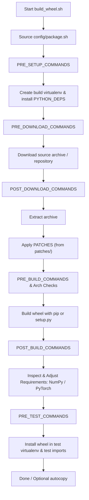

# Configuration Recipes

Configuration files provide package-specific customization or steps required to build or patch a Python wheel.
One can create version-specific configuration files using `${PACKAGE}-${VERSION}.sh` or general ones using `${PACKAGE}.sh`.

`build_wheel.sh` and `unmanylinuxize.sh` search the `config/` directory and source configuration files in the following order:
1. `${PACKAGE}-${VERSION}.sh`
2. `${PACKAGE}.sh`

To inspect practical recipes, browse the [`config/*.sh`](https://github.com/ComputeCanada/wheels_builder/tree/main/config) files in the repository.

## Execution Lifecycle

The following diagram illustrates the execution flow in `build_wheel.sh` and where each configuration hook executes:

## Variables

| Variable | Description |
| :--- | :--- |
| `PACKAGE` | Name of the package. Defaults to `--package`. |
| `VERSION` | Version of the package. Defaults to `--version` or latest from PyPI. |
| `PYTHON_VERSIONS` | List of Python versions to build for. Defaults to active versions in the current StdEnv (e.g. 3.11, 3.12, 3.13 in 2023; 3.14+ in 2026). |
| `BDIST_WHEEL_ARGS` | Extra arguments passed to `python setup.py bdist_wheel $BDIST_WHEEL_ARGS`. |
| `PIP_WHEEL_ARGS` | Extra arguments passed to `pip wheel $PIP_WHEEL_ARGS`. |
| `MODULE_BUILD_DEPS` | EasyBuild/Lmod modules loaded specifically for building the wheel. |
| `MODULE_BUILD_DEPS_DEFAULT` | Default modules loaded for building: dynamically includes `$NUMPY_MODULE`, `python-build-bundle`, `pytest`, `cython/$CYTHON_VERSION`, and `rust`. |
| `MODULE_RUNTIME_DEPS` | Modules loaded during both building and testing of the wheel. |
| `PACKAGE_DOWNLOAD_CMD` | Custom download command (defaults to `pip download -v --no-cache --no-binary :all: --no-use-pep517 --no-build-isolation --no-deps $PACKAGE_DOWNLOAD_ARGUMENT`). |
| `PACKAGE_DOWNLOAD_ARGUMENT` | Argument passed to download command (default: `$PACKAGE==$VERSION` or `$PACKAGE`). |
| `PACKAGE_DOWNLOAD_NAME` | Archive name if different from `$PACKAGE` (default: `$PACKAGE`). |
| `PACKAGE_DOWNLOAD_METHOD` | Set to `"Git"` when checking out source code from a git repository. |
| `PACKAGE_FOLDER_NAME` | Directory name of the extracted archive if different from `$PACKAGE`. |
| `PACKAGE_SUFFIX` | Suffix to append to the package name in `setup.py` (e.g. `-cpu` or `-gpu`). |
| `PATCHES` | Space-separated list of patch files in the `patches/` directory to apply with `patch -p1`. |
| `PATCH_WHEEL_COMMANDS` | Shell commands to patch an already-built wheel (used when downloaded as `.whl` or under `unmanylinuxize.sh`). |
| `PRE_SETUP_COMMANDS` | Shell commands executed before creating the build virtualenv. |
| `PRE_DOWNLOAD_COMMANDS` | Shell commands executed before downloading the package source. |
| `POST_DOWNLOAD_COMMANDS` | Shell commands executed immediately after downloading the package. |
| `PRE_BUILD_COMMANDS` | Shell commands executed immediately before compiling the wheel. |
| `POST_BUILD_COMMANDS` | Shell commands executed after the wheel is built. |
| `PRE_TEST_COMMANDS` | Shell commands executed inside the test environment before verifying module imports. |
| `PYTHON_DEPS` | Additional Python dependencies installed into the build virtualenv via `pip install`. |
| `PYTHON_DEPS_DEFAULT` | Default build Python packages: `setuptools>70 pip>=25.0`. |
| `PYTHON_IMPORT_NAME` | Module name to import if different from package name (e.g. `PACKAGE=pyzmq` vs `import zmq`). |
| `PYTHON_TESTS` | Python code executed via `python -c "import $NAME; $TESTS"` to verify wheel functionality. |
| `TEST_COMMAND` | Custom shell command to run for testing instead of standard import testing. |
| `RPATH_TO_ADD` | Colon-separated paths to append to binary RPATHs via `setrpaths.sh --add_path $RPATH_TO_ADD`. |
| `RPATH_ADD_ORIGIN` | If set, runs `setrpaths.sh --add_origin`. |
| `UPDATE_REQUIREMENTS` | Requirements to modify using `manipulate_wheels.py` after building. |
